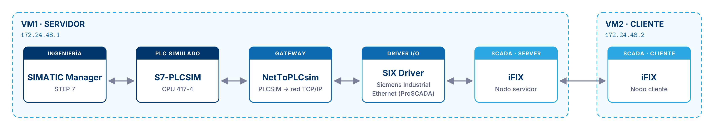

# Alcance

# Simulador de planta de lecitina (Bélgica)
 
Réplica por software de una planta belga de secado de lecitina.
Simulación integra de las entradas y salidas y hardware de campo.
El programa original del PLC corre sin cambios sobre PLCSIM y una capa de simulación reproduce la respuesta del proceso. 
Fue propuesto y armado para entrenar operadores en escenarios de falla características de la planta.
 
## Stack
 
- Siemens STEP 7 Classic v5.7 + S7-PLCSIM (S7-400, CPU 417-4).
- iFIX como SCADA/HMI, conectado a PLCSIM con el driver SIX/PSDirect a través de NetToPLCsim (ISO-on-TCP, puerto 102).
- Dos VMs: VM1 con STEP 7, PLCSIM y el nodo servidor iFIX; VM2 como nodo View/iClient por red iFIX.

## Enfoque
 
- **Programa original intacto:** las FCs de simulación escriben sobre las direcciones de I/Q o fuerzan bits de DB. Así las rutinas existentes (`FC_Copy_Ingangen`, `FC_Oproep_motor`, etc.) las toman sin modificarse, y se conserva la nomenclatura original en neerlandés.
- **Señales externas:** las señales de campo y de otros PLCs (refinería, extracción) se emulan o se puentean de forma controlada, respetando las alarmas e interlocks que dependen de ellas con un comportamiento lógico.
- **Estados de planta:** el estado se selecciona automáticamente según los pasos de las secuencias, y los valores de proceso se inyectan según ese estado.

## Modelo de proceso
 
- 54 válvulas on/off con realimentación de posición (lógica negativa en la sección EL, positiva en ZL). En las válvulas de control, la posición sigue a la salida del lazo.
- 16 motores con realimentación de marcha derivada del comando.
- 33 entradas digitales de instrumentos (niveles, presiones, temperaturas).
- 115 variables analógicas con setpoints definidos por estado de planta.
- Dinámica: apertura de válvula → caudal, filtros LEAD_LAG (FB80) e integrador de temperatura. Los caudales van a cero según el estado de válvulas y bombas.
- Lazos destacados: cascada de nivel → caudal, selectores de mínimo (auctioneering) y rampa de vacío durante el arranque.
- Estados de planta: Running, Stopped, Startup Flush, Shutdown Flush 50% y Shutdown Flush 100%.

## Entrenamiento y validación
 
- 5 escenarios de falla pensados para entrenar operadores: vibración, descarga bloqueada, vacío, falta de ácido y baja temperatura.
- Validado y ajustado con el cliente y los operadores de planta mediante un proceso iterativo de comunicación y correcciones.

# Figuras

